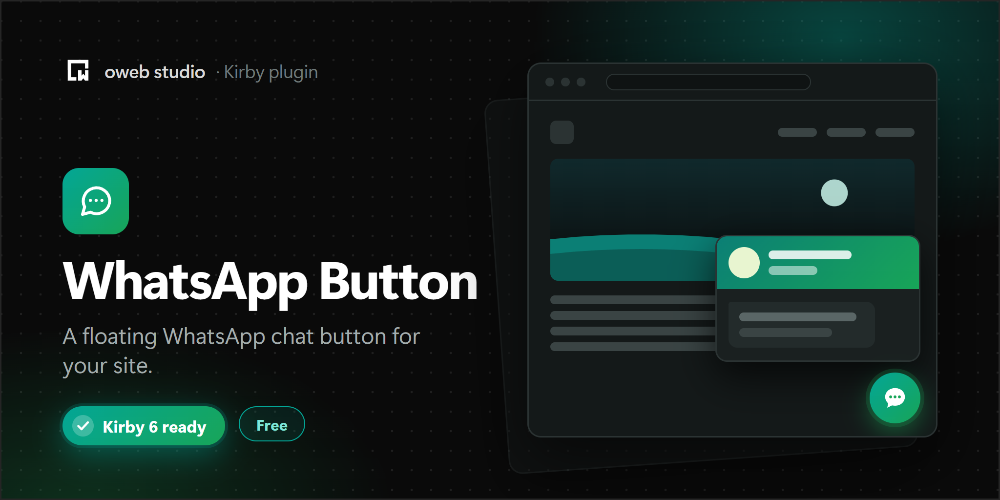

# 💬 Kirby WhatsApp Button

A floating WhatsApp chat button for your Kirby site. Visitors open a small chat window, type a message and continue the conversation in WhatsApp.


- Settings in the config, in the Panel or per snippet
- One or more agents, each with their own number
- Office hours with an offline state, or a button that hides itself
- Page placeholders for messages that tell you where the visitor came from
- No requests to other services by default and no cookies
- Usable with the keyboard and screen readers
- Texts in English, German and Turkish

## Requirements

- Kirby 5 or 6
- PHP 8.2 or newer (Kirby 6 needs PHP 8.3)

For Kirby 3.4 to 4, use version 1.x of this plugin.

## Installation

1. Download the latest release
2. Unzip downloaded file
3. Copy/paste unzipped folder in your `/site/plugins` folder

Or with Composer:

```
composer require owebstudio/kirby-whatsapp-button
```

## Usage

Add the snippet to your templates, for example right before `</body>`:

```php
<?php snippet('whatsapp-button') ?>
```

and set your number in `/site/config/config.php`:

```php
return [
    'owebstudio.whatsapp-button' => [
        'phone' => '+49 30 1234567',
    ],
];
```

The number needs the country code. Spaces, dashes and the leading `+` are removed for the WhatsApp link.

The snippet loads the stylesheet and the script of the plugin. The widget doesn't need an inline script, so it works with a Content Security Policy that only allows scripts from your own domain.

## Panel settings

Editors can change the number, the texts, the agents and the office hours in the Panel. Add the ready-made tab to your `site.yml` blueprint:

```yaml
# /site/blueprints/site.yml
tabs:
  content:
    # your existing fields
  whatsapp: tabs/whatsapp-button
```

or the fields anywhere in your site blueprint:

```yaml
fields:
  whatsappButton: fields/whatsapp-button
```

Fields left empty in the Panel use the options from your config. Options passed to the snippet win over both. The "Show the WhatsApp button" toggle can switch the button off; when it is on, the `enabled` option still decides.

In multi-language sites, the name, the status, the messages and the agents can be translated. The number, the avatar and the office hours are the same in every language.

## Agents

With more than one agent, the chat window shows a list and visitors choose who they want to chat with:

```php
'owebstudio.whatsapp-button' => [
    'agents' => [
        [
            'name'   => 'Sales',
            'phone'  => '+49 30 1234567',
            'status' => 'Typically replies within an hour',
            'avatar' => 'https://example.com/media/sales.jpg',
        ],
        [
            'name'  => 'Support',
            'phone' => '+49 30 7654321',
        ],
    ],
],
```

Each agent needs a `phone`. `name`, `status`, `avatar` and `hours` are optional. Agents without an avatar get their initials.

## Office hours

```php
'owebstudio.whatsapp-button' => [
    'phone'    => '+49 30 1234567',
    'timezone' => 'Europe/Berlin',
    'hours'    => [
        'mon-fri' => '09:00-12:00, 13:00-17:00',
        'sat'     => '10:00-14:00',
    ],
],
```

- Days are `mon`, `tue`, `wed`, `thu`, `fri`, `sat` and `sun`, alone, as a range (`mon-fri`) or as a list (`sat, sun`).
- A time range that ends after midnight (`22:00-02:00`) continues on the next day.
- Without `hours`, the button is always online.
- `timezone` defaults to the time zone of PHP on your server.

Outside of the office hours, the status shows `offlineStatus` and the chat window shows `offlineMessages`. Visitors can still send a message. Set `'outsideHours' => 'hide'` to hide the button instead.

Agents can have their own `hours`; agents without them use the office hours of the button. With `'outsideHours' => 'hide'`, only the agents that are available are listed.

The office hours are checked in the browser of the visitor, so they also work with Kirby's page cache.

## Page placeholders

`messages`, `offlineMessages`, `defaultMessage` and `placeholder` can contain `{{ page.title }}`, `{{ page.url }}`, `{{ site.title }}` and `{{ site.url }}`:

```php
'defaultMessage' => 'Hi, I have a question about {{ page.title }} ({{ page.url }})',
```

Other queries are not resolved, because editors can set these texts in the Panel.

## Options

All options can be set in `/site/config/config.php` with the `owebstudio.whatsapp-button` prefix, or passed to the snippet.

| Option            | Type                | Default                  | Description                                                                          |
|:------------------|:--------------------|:-------------------------|:-------------------------------------------------------------------------------------|
| enabled           | bool&#124;Closure   | `true`                   | Shows or hides the button                                                            |
| phone             | string              |                          | WhatsApp number with the country code (required without `agents`)                   |
| agents            | array               | `[]`                     | Agents with `name`, `phone`, `status`, `avatar` and `hours`, see [Agents](#agents)   |
| position          | string              | `right`                  | `left` or `right`                                                                    |
| name              | string              | Site title               | Name in the header of the chat window                                                |
| avatar            | string              | Initials of the name     | Image URL for the header of the chat window                                          |
| status            | string              | `online`                 | Status text under the name                                                           |
| showStatus        | bool                | `true`                   | Shows or hides the status text                                                       |
| messages          | string&#124;array   | Hello, how can we help you? | Messages in the chat window, an array shows one message every two seconds         |
| placeholder       | string              | Type here...             | Placeholder of the message input                                                     |
| defaultMessage    | string              | Hello                    | Message sent to WhatsApp when the visitor leaves the input empty                     |
| hours             | array               | `[]`                     | Office hours, see [Office hours](#office-hours)                                      |
| timezone          | string              | PHP time zone            | Time zone of the office hours                                                        |
| outsideHours      | string              | `offline`                | `offline` shows the offline status and messages, `hide` hides the button             |
| offlineStatus     | string              | `offline`                | Status text outside of the office hours                                              |
| offlineMessages   | string&#124;array   | We are away right now. … | Messages outside of the office hours                                                 |
| showBadge         | bool                | `true`                   | Shows a badge on the button                                                          |
| countBadge        | int                 | `1`                      | Text of the badge                                                                    |
| timeoutBadge      | int                 | `1500`                   | Delay before the badge appears (ms)                                                  |
| autoOpen          | bool                | `true`                   | Opens the chat window automatically                                                  |
| autoOpenTimeout   | int                 | `5000`                   | Delay before the chat window opens automatically (ms)                                |
| doNotDisturb      | bool                | `false`                  | Opens the chat window automatically only once per browser tab                        |
| alwaysOpen        | bool                | `false`                  | Opens the chat window on every page, also with `doNotDisturb`                        |
| alwaysOpenTimeout | int                 | `2500`                   | Delay before the chat window opens with `alwaysOpen` (ms)                            |
| buttonLabel       | string              | Chat on WhatsApp         | Label of the button for screen readers                                               |
| sendLabel         | string              | Send                     | Label of the send button for screen readers                                          |
| backLabel         | string              | Back                     | Label of the back button to the list of agents for screen readers                   |

### Conditional button

```php
return [
    'owebstudio.whatsapp-button' => [
        'phone' => '+49 30 1234567',
        'enabled' => function () {
            return page()->template()->name() !== 'checkout';
        },
    ],
];
```

For times of the day, use [office hours](#office-hours): the `enabled` closure runs on the server and doesn't change while a page is cached.

### Multiple messages

```php
return [
    'owebstudio.whatsapp-button' => [
        'phone' => '+49 30 1234567',
        'messages' => [
            'Welcome to our site!',
            'How can I help you?'
        ],
    ],
];
```

### Options per page

```php
<?php snippet('whatsapp-button', ['options' => [
    'name' => 'John Doe',
    'phone' => '+49 30 1234567'
]]) ?>
```

## Translations

The default texts follow the language of the page in multi-language sites and are available in English, German and Turkish. Set the text options in your config or in the Panel to use your own.

## Upgrading from 1.x

- Requires Kirby 5 or 6 and PHP 8.2.
- Without an `avatar`, the chat window shows the initials of the name instead of an image from ui-avatars.com.
- The widget opens `https://wa.me/<number>`. Messages with `&`, `#` or `+` arrive complete now.
- The assets moved to `assets/whatsapp-button.css` and `assets/whatsapp-button.js`, and the snippet loads them with a cache busting URL. If you copied the old asset paths into your templates, use the snippet instead.
- The container has no `whatsapp-button` ID anymore. It keeps the `whatsappButton` class, and the open chat window uses the `is-open` class (`is-active` was removed).
- The toggle and send buttons are `<button>` elements, and the input is part of a form.
- `doNotDisturb` remembers the opened chat window in the session storage instead of a cookie.

## License

MIT
